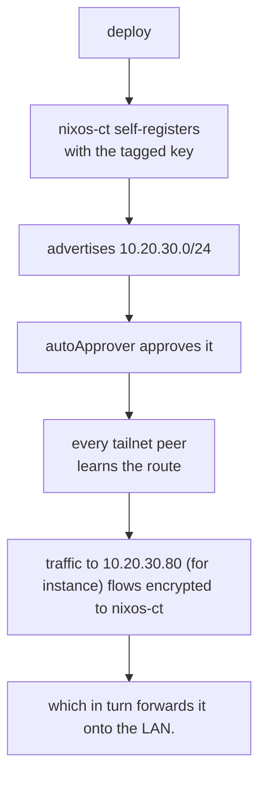

# Tailscale setup

1. Signup (creating a tailnet).
2. Access controls -> Tags -> Create a new tag (`tag:subnet-router`) and set the
   owner.
3. Access controls -> Auto-approver -> Routes -> Add route:
   - Route: `10.20.30.0/24`.
   - Route is auto-approved for: `tag:subnet-router`.
   - Note: auto-approvers don't retroactively approve already-advertised routes.
4. Settings -> Trust credentials -> (new) OAuth. Give the token the `auth_keys`
   (write) access scope with the `tag:subnet-router` tag.
   - Its secret doesn't expire, unlike auth keys (90 days max).
5. Supply the client secret to the Nix module with `agenix` (see [agenix-rules.nix](../Nix/secrets/agenix-rules.nix)).
6. The LXC needs the TUN device + nesting (see the [Ansible playbook](../ansible/playbooks/proxmox-nixos-ct.yaml),
   apply with `just pve-postconfig`).
7. Deploy the Tailscale NixOS module with `deploy-rs` (`just nix-deploy`).
8. Then back to the Tailscale admin console:
   1. DNS → Nameservers → Add nameserver → Custom, then enter your local DNS
      server's (e.g., AdGuard's) tailnet IP (`100.x.y.z`). You can either...
      - Restrict to domain: e.g., `k8s.murtadha.dev` (and repeat for other domains
        like `home.murtadha.dev`) to only direct DNS queries for those names to
        the local DNS server. Or...
      - Don't restrict to domain, but instead add the server and then toggle 'Override
        DNS servers' to resolve all names outside the tailnet via that address
        (i.e. when away, clients direct *all* DNS queries to the AdGuard server
        at home through the subnet-router).
      - We use the tailnet IP instead of the LAN IP because the tailnet IP works
        from any peer regardless of whether the local subnet route is approved,
        whether that peer has `--accept-routes` on, or whether the peer's own LAN
        collides with the advertised route. Pointing at the LAN address would also
        make tailnet DNS dependent on subnet routing working.
   2. MagicDNS enabled ✅.
   3. Tailscale disables key expiry by default for tagged devices ✅.

## Workflow

> [!NOTE]
> A **subnet router** is a node that bridges the tailnet and a *physical subnet*:
> it sits on both (`nixos-ct` is on the LAN at `10.20.30.50` and on the tailnet at
> some `100.x.y.z`) and forwards packets between the WireGuard tunnel and the LAN.

## Redundancy

`nixos-ct-2` (on `prox2`) is a second subnet router and AdGuard instance, so remote
access and DNS survive `nixos-ct` or `prox` going down.

- **Routing fails over automatically**: both nodes advertise the *exact same*
  prefix (a broader route doesn't count as a fallback). The oldest advertiser
  (`nixos-ct`) is primary; the other takes over within ~15s of it going offline,
  dropping open connections.
- **DNS doesn't fail over on its own**: add `nixos-ct-2`'s tailnet IP as a second
  global nameserver next to `nixos-ct`'s (step 8.1), otherwise every tailnet client
  loses DNS with `nixos-ct`.
- The TUN device comes from the same [Ansible playbook](../ansible/playbooks/proxmox-nixos-ct.yaml)
  as above, and the host's (public) SSH key must be a recipient of `tailscale-oauth-secret.age`
  before its first deploy.
